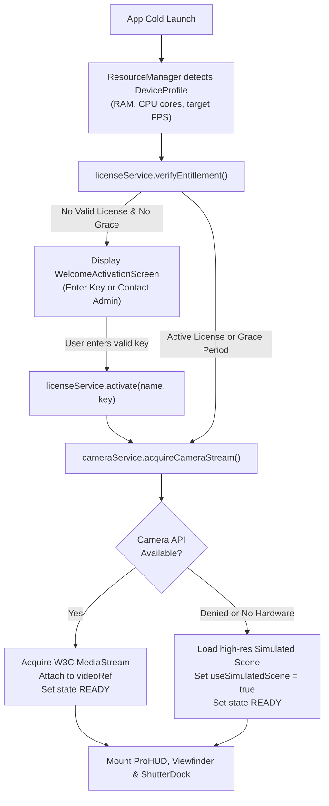
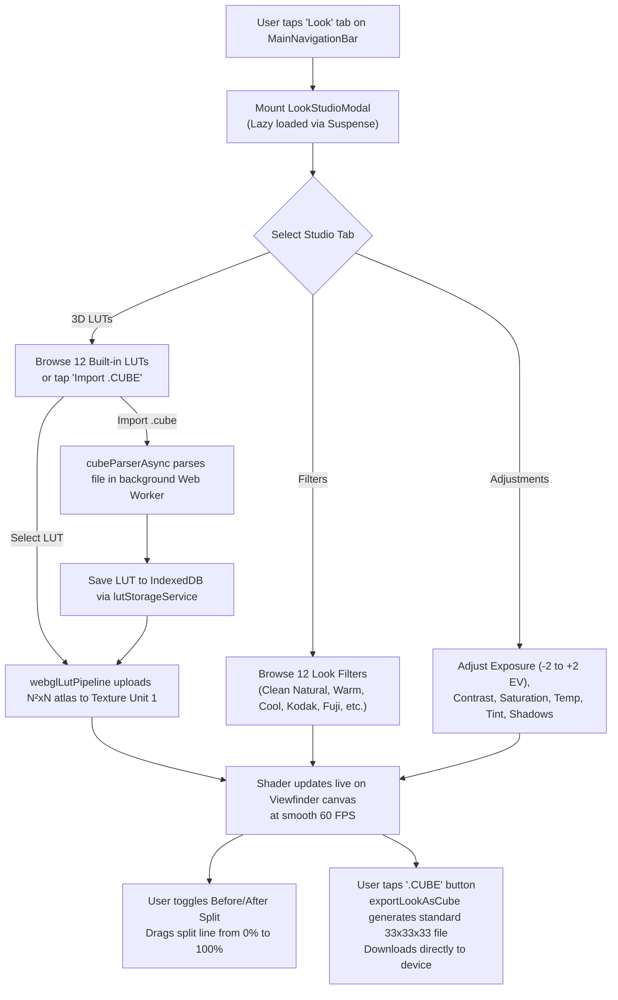
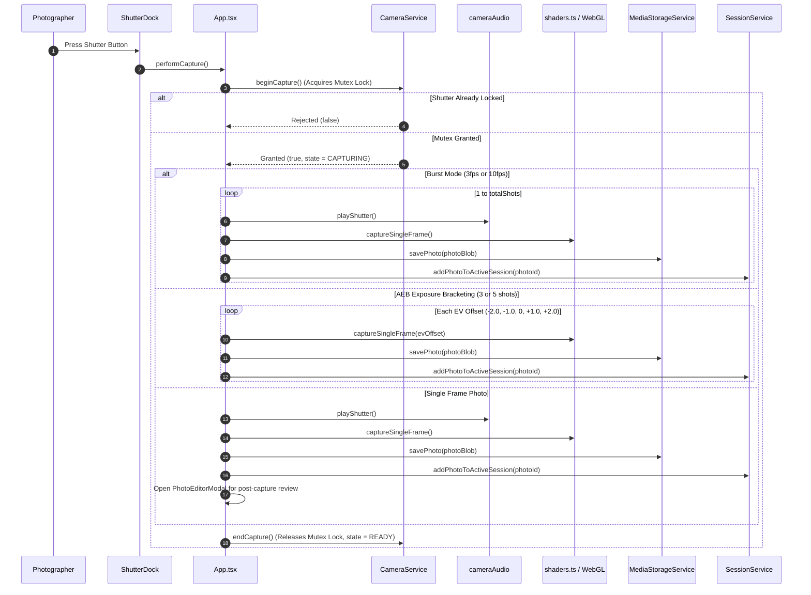

# Application Lifecycle & Feature Workflows — CineGrid Pro

This document maps out the end-to-end user and system workflows in CineGrid Pro, from cold launch to final asset export.

---

## 1. Application Startup & Entitlement Workflow

---

## 2. Composition Guidance Workflow
1. **Grid Selection:**
   - User opens the Grid drawer or taps the `Grid` pill on the top navigation bar.
   - User selects from 12+ composition models (Rule of Thirds, Golden Ratio, Golden Spiral, Golden Triangle, Dynamic Symmetry, Perspective, Crosshairs, Safe Areas).
   - `GridRenderer.tsx` dynamically calculates SVG coordinates for the active viewfinder aspect ratio without redrawing the camera canvas.
2. **Reference Photo Alignment (Ghost Overlay):**
   - User taps the Ghost button in the viewfinder top bar to open `GhostOverlayDrawer`.
   - User selects an existing photograph from the local gallery or active session reference images.
   - The selected image is superimposed over the live viewfinder in `GhostOverlayView`.
   - User adjusts opacity (0–100%), scale (0.5x–3.0x), rotation (0–360°), and touch position offsets to align real-world subjects with the reference photo.
   - User taps "Lock Position" to prevent accidental movement during shooting.
3. **Reference Photo Showcase:**
   - User opens `GridReferenceModal` to inspect 3 real photographs demonstrating exact subject placement for the selected grid.

---

## 3. Blackmagic Pro Camera Controls Workflow
1. **Exposure Mode:**
   - User selects `ISO Auto` or taps manual ISO values (100, 200, 400, 800, 1600, 3200, 6400).
   - User selects `Shutter Auto` or dials manual speeds (`1/1000s`, `1/500s`, `1/250s`, `1/120s`, `1/60s`, `1/50s`, `1/24s`).
   - If in video mode, user can toggle the **180° Cinema Shutter Rule**, which automatically calculates the exact shutter speed based on the target recording frame rate ($1 / (2 \times \text{FPS})$).
2. **White Balance:**
   - User adjusts Kelvin color temperature from 2800K (incandescent warm) to 8000K (overcast cool).
3. **Focus & Metering:**
   - User taps anywhere on the camera viewfinder.
   - `cameraService.applyTapToFocus` passes normalized $(x, y)$ coordinates to hardware `pointsOfInterest`.
   - The animated focus reticle tracks the point and locks with acoustic feedback (`cameraAudio.playFocusLock()`).

---

## 4. Live 3D LUT & Filter Color Grading Workflow

---

## 5. Shutter Capture & Bracketing Workflow

---

## 6. Post-Capture Lightroom Photo Editing Studio
1. **Launch:** Opened automatically after single photo capture, or launched from the local photo gallery.
2. **Light & Exposure Panel:**
   - Sliders for Exposure, Contrast, Highlights, Shadows, Whites, Blacks, and Brightness.
   - Interactive RGB Tone Curve Editor: editable control points across Red, Green, Blue, and composite RGB channels.
3. **Color & HSL Mixer Panel:**
   - Temperature, Tint, Vibrance, Saturation.
   - 8-Channel HSL Color Mixer (Red, Orange, Yellow, Green, Aqua, Blue, Purple, Magenta) with independent Hue, Saturation, and Luminance sliders.
4. **Detail & Optics Panel:**
   - Sharpening, Radius, Detail masking, Luminance Noise Reduction, Vignette amount, and Midpoint.
5. **Geometry Panel:**
   - Straighten angle (-45° to +45°), Horizontal perspective keystone, Vertical perspective keystone.
6. **Comparison & Export:**
   - Interactive Before/After split comparison wipe slider.
   - "Save Edits" persists edited photo to IndexedDB via `MediaStorageService`.
   - "Open Export Studio" routes directly into multi-format print and digital export.

---

## 7. Photography Sessions Workflow
1. **Create Session:**
   - Photographer creates a client shoot (e.g., "Vogue Studio High Fashion", "Sunset Wedding").
   - Enters client description, lighting notes, preferred lens focal lengths, and camera presets.
   - Uploads reference inspiration photos into the session.
2. **Shoot Session:**
   - Tapping "Shoot This Session" auto-configures the camera viewfinder:
     - Applies the session's preferred composition grid.
     - Sets the session's preferred aspect ratio.
     - Loads the first reference photo into the Ghost Overlay alignment tool.
3. **Photo Assignment:**
   - Every photograph captured during the shoot is automatically assigned to the active session ID.
   - Photographer inspects shoot progress and photo count in `SessionsManagerModal`.

---

## 8. Professional Export Studio Workflow
1. **Source Selection:** User selects active photo from gallery or post-capture review.
2. **Format & Quality Configuration:**
   - Format: JPEG (maximum compatibility), PNG (lossless fidelity), WebP (modern high compression).
   - Compression Quality: 10% to 100%.
3. **Print Sizing & Resolution:**
   - Full Sensor (Native 100%).
   - Standard Print Scales: A4 Document, 8x10 Studio Print, 5x7 Portrait, 4x6 Postcard.
4. **Composition Burn-in & EXIF:**
   - User can optionally burn the active composition grid lines directly into the exported image for client proofing or photography instruction.
   - EXIF Metadata embedding: preserves ISO, Shutter Speed, White Balance, EV offset, and lens tag.
5. **Download / Native Save:**
   - On Web: triggers browser file download.
   - On iOS / Android: uses `@capacitor/filesystem` to save directly to the native Camera Roll.

---

## 9. Advanced Capture Studio Workflows

### A. Audio Intelligence Studio Workflow
1. **Studio Access:** Tapping the audio meter pill or opening Pro Settings Drawer -> "Audio Studio" launches `AudioStudioModal.tsx`.
2. **DSP Mode Selection:** User selects one of 6 audio processing algorithms:
   - `Off` (Bit-exact mic bypass)
   - `Standard` (Gentle 12dB compression & high-pass)
   - `Strong` (Aggressive background noise attenuation)
   - `Wind Reduction` (130Hz steep highpass filter)
   - `Voice Focus` (Formant peaking boost at 2.5kHz)
   - `Auto Adaptive` (Dynamic spectral gating)
3. **Microphone Routing:** Hardware enumeration lists connected USB audio interfaces, Bluetooth mics, and wireless systems (DJI Mic, Røde Wireless GO) alongside built-in microphones.
4. **Real-time Telemetry:** 30 FPS stereo decibel meter displays RMS (-60dB to 0dB), peak holding, and digital clipping indicators.
5. **Clip Test Recorder:** Users can record a 5-second test snippet to monitor DSP performance with processed audio playback before shooting.
6. **Unified Media Stream Sync:** When video recording starts, `audioIntelligenceService.getProcessedAudioStream()` feeds into the MediaRecorder stream, recording synchronized, noise-reduced audio directly into video files.

### B. Dual Camera Multi-Stream Workflow
1. **Mode Switch:** Selecting `DUAL` in the mode bar prompts `dualCameraService.probeDualCameraSupport()`.
2. **Hardware Verification:** Checks browser and platform concurrent stream constraints. If the hardware ISP supports concurrent sensors, secondary front/rear stream initializes. If single-ISP hardware is present, an informational banner appears while allowing layout preview.
3. **Layout Selection:** Photographer selects `PIP`, `Split-Vertical`, or `Split-Horizontal`.
4. **Interactive Controls:**
   - PIP window can be dragged to any viewport corner or toggled between small (20%) and large (32%) sizes.
   - Quick Swap button instantly reverses primary and secondary camera feeds.
5. **Compositing Recording:** Video recording composites both camera streams onto an off-screen canvas at full capture resolution with synchronized audio.

### C. Computational Night Mode Workflow
1. **Mode Selection:** Swiping to `NIGHT` mode mounts `NightModeControls.tsx`.
2. **Duration Configuration:** User chooses `Auto`, `10s`, `30s`, or dials custom exposure seconds (1s to 30s).
3. **Hardware Query:** Checks if hardware sensor exposes native `exposureTime` constraint.
4. **Shutter Trigger:**
   - Shutter button displays amber night icon.
   - Live countdown displays remaining exposure seconds and frame accumulation count.
   - Stability score meter tracks gyro and inter-frame motion, instructing user to hold steady.
5. **Computational Stacking Pipeline:** For devices without hardware long exposure, samples consecutive frames into a 32-bit Float accumulation buffer, averages high-frequency temporal noise, and applies an adaptive shadow curve to illuminate underexposed details.
6. **Direct Editor Hand-off:** Captured night photo is automatically ingested into the gallery and opened in the Lightroom Photo Studio for grading.

### D. Wide Selfie & Group Framing Workflow
1. **Selfie Detection:** Switching to front camera displays `WideSelfieControls.tsx`.
2. **Lens Selection:** Checks for physical ultrawide front sensor. Allows switching between 1.0x (standard portrait) and 0.7x/0.5x (wide group framing).
3. **Group Guide Overlay:** Tapping "Group Guide" projects SVG face alignment anchors and a 12% edge margin warning boundary to safeguard peripheral subjects from optical wide-angle barrel distortion.

### E. High-Speed Slow Motion Workflow
1. **Mode Selection:** Selecting `SLOW-MO` inspects sensor capabilities for 60, 120, or 240 FPS support.
2. **Framerate Setting:** High-speed capture constraints are dispatched to the camera track.
3. **Recording & Preview:** Records at target sensor framerate with real-time UI timer.
4. **Playback Speed Selection:** User can preview and export at 0.5x (half-speed), 0.25x (quarter-speed), or 0.125x (eighth-speed).

### F. Time-lapse Recording Workflow
1. **Interval Selection:** Choosing `TIME-LAPSE` presents interval steps: 0.5s, 1s, 2s, 5s, 10s, 30s.
2. **Readiness Audit:** Pre-flight check audits battery level ($> 20\%$) and estimated storage space.
3. **Duration Estimator:** Real-time HUD pill shows projected video length (e.g., "10m real = 10s video @ 30 FPS").
4. **Incremental Memory-Safe Capture:** Captures individual frames on timer ticks and streams directly to video encoder without accumulating full-resolution bitmaps in JavaScript RAM.
5. **Export:** On recording stop, finishes encoding and prompts direct download of the rendered time-lapse video.
