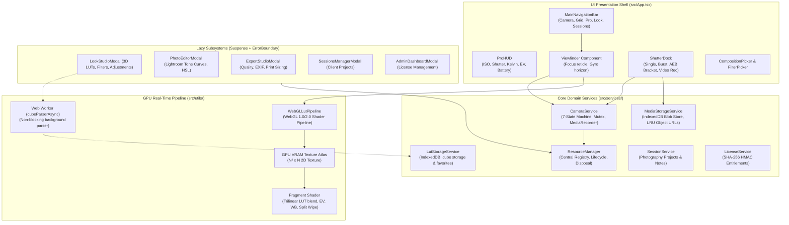
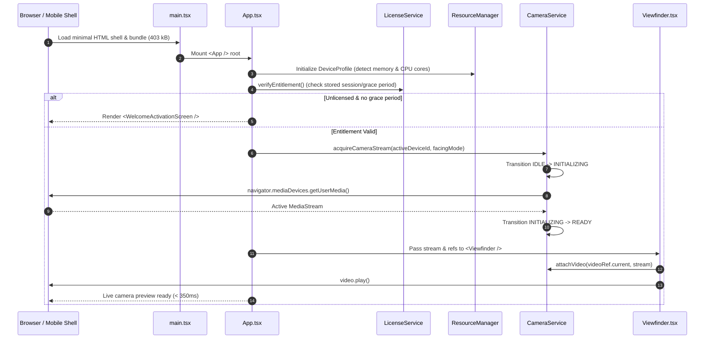
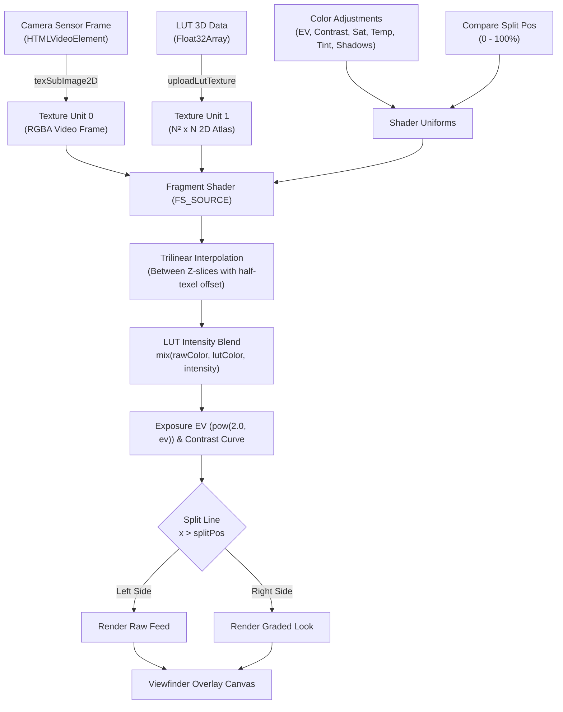

# Application Architecture — CineGrid Pro

## 1. Architectural Philosophy
CineGrid Pro is architectured around three core pillars:
1. **Camera Stream Independence:** The core video acquisition pipeline is decoupled from the UI, composition overlays, and color grading filters. Changing grids, tweaking LUT intensity, or opening modal tools never restarts or pauses the underlying `MediaStreamTrack`.
2. **GPU Shader Acceleration with Texture Reuse:** Live color grading occurs entirely in GPU fragment shaders using WebGL 2D texture atlases. To eliminate GC pauses and memory allocations, textures are allocated once and updated via `gl.texSubImage2D`.
3. **Resource Ownership & Memory Budgeting:** Every hardware stream, WebGL context, Object URL, timer, and event listener is registered with the central `ResourceManager` and bound to an explicit owner ID, enabling deterministic cleanup when components unmount.

---

## 2. High-Level Architecture Diagram



---

## 3. Application Initialization & Startup Flow



---

## 4. Component Hierarchy & File Mapping

```
App.tsx (Root State Coordinator & ErrorBoundary Boundary)
├── MainNavigationBar.tsx (Primary tab router: Camera | Grid | Pro | Look | Sessions | Gallery)
├── Viewfinder.tsx (Central sensor display)
│   ├── <video> (Native sensor hardware stream)
│   ├── <canvas> (GPU WebGL 3D LUT live shader overlay)
│   ├── SmartFramingOverlay.tsx (Composition guide rule lines)
│   ├── GhostOverlayView.tsx (Transparent reference photo alignment)
│   ├── GridRenderer.tsx (Selectable composition SVG grids)
│   ├── Artificial Horizon (Gyroscope roll/pitch dual-axis level)
│   └── Focus Reticle (Hardware tap-to-focus indicator)
├── ProHUD.tsx (Top & bottom camera metadata bar)
│   ├── BlackmagicAudioMeter.tsx (Web Audio real-time stereo VU dB meters)
│   ├── BlackmagicQuickPresets.tsx (Cinema, Studio, Action, Documentary)
│   └── Battery & Storage Indicators
├── ZoomControl.tsx (0.5x, 1x, 2x, 5x digital & optical hardware zoom)
├── CompositionPicker.tsx (Grid thumbnail carousels)
├── FilterPicker.tsx (Quick color filter presets)
├── TickDial.tsx (Tactile precision slider dial for ISO, Shutter, Kelvin)
├── ShutterDock.tsx (Capture button, mode selector, burst counter)
├── ProSettingsDrawer.tsx (Full-screen manual exposure controls)
│
└── Lazy Modals (Wrapped in React.Suspense and ErrorBoundary):
    ├── LookStudioModal.tsx (3D LUTs, Filters, Adjustments, Before/After Split)
    ├── PhotoEditorModal.tsx (Lightroom-inspired Tone Curves, HSL, Details)
    ├── ExportStudioModal.tsx (Multi-format exporter, print sizing, EXIF)
    ├── SessionsManagerModal.tsx (Client photoshoot organizer)
    ├── AdminDashboardModal.tsx (License key generator & device manager)
    ├── LicenseInfoModal.tsx (Current license status & device ID)
    ├── ContactAdminModal.tsx (License request form)
    ├── MasterPresetsModal.tsx (One-touch master photography looks)
    ├── GridCustomizerModal.tsx (Custom grid line colors, widths, opacity)
    ├── GridReferenceModal.tsx (3 sample photos per composition grid)
    └── GhostOverlayDrawer.tsx (Ghost reference image picker & transform controls)
```

---

## 5. State Management Domain Architecture

Rather than maintaining a single monolithic state store, CineGrid Pro isolates state into distinct, decoupled domains:

| Domain | Responsible File / Service | State Variables | Isolation Strategy |
| :--- | :--- | :--- | :--- |
| **Camera Engine** | [`src/services/cameraService.ts`](file:///C:/Users/yates/.gemini/antigravity/scratch/cinegrid-cam/src/services/cameraService.ts) | `state` (`idle`, `initializing`, `ready`, `capturing`, `recording`, `stopping`, `error`), `currentStream` | Strict state machine with transition validator. External subscribers listen via `onStateChange()`. |
| **Pro Exposure** | [`src/App.tsx`](file:///C:/Users/yates/.gemini/antigravity/scratch/cinegrid-cam/src/App.tsx) | `proSettings` (`iso`, `shutterSpeed`, `shutterAngle`, `whiteBalance`, `ev`, `burstMode`) | Persisted to `localStorage` under `cinegrid_pro_photo_settings` and `cinegrid_pro_video_settings`. |
| **Composition Grid** | [`src/App.tsx`](file:///C:/Users/yates/.gemini/antigravity/scratch/cinegrid-cam/src/App.tsx) | `selectedGrid`, `gridStyle`, `secondaryGuides` | Persisted to `localStorage`. Grid rendering is isolated to SVG layers without touching camera buffers. |
| **Look & 3D LUT** | [`src/App.tsx`](file:///C:/Users/yates/.gemini/antigravity/scratch/cinegrid-cam/src/App.tsx), [`src/services/lutStorageService.ts`](file:///C:/Users/yates/.gemini/antigravity/scratch/cinegrid-cam/src/services/lutStorageService.ts) | `lookState` (`activeLutId`, `lutIntensity`, `adjustments`, `isCompareActive`, `compareSplitPosition`) | LUT float tables stored in IndexedDB. Live changes passed directly to WebGL shader uniforms. |
| **Photo Captures** | [`src/services/mediaStorageService.ts`](file:///C:/Users/yates/.gemini/antigravity/scratch/cinegrid-cam/src/services/mediaStorageService.ts) | `capturedPhotos` | Heavy binary images stored as native Blobs in IndexedDB. React state only retains metadata and ephemeral Object URLs. |
| **Sessions** | [`src/services/sessionService.ts`](file:///C:/Users/yates/.gemini/antigravity/scratch/cinegrid-cam/src/services/sessionService.ts) | `sessions`, `activeSessionId` | Stored in `localStorage`. Stores photo IDs only to prevent memory duplication. |
| **Licensing** | [`src/services/licenseService.ts`](file:///C:/Users/yates/.gemini/antigravity/scratch/cinegrid-cam/src/services/licenseService.ts) | `isLicenseActivated`, `licenseSession` | Cryptographic HMAC SHA-256 session tokens stored in `localStorage`. |

---

## 6. Real-Time GPU 3D LUT Pipeline



---

## 7. Fault Isolation & Error Boundaries
To prevent crashes in experimental or user-facing tools from bringing down the viewfinder:
- **`ErrorBoundary.tsx`** encapsulates each heavy modal (`LookStudioModal`, `PhotoEditorModal`, `ExportStudioModal`, `SessionsManagerModal`, `AdminDashboardModal`).
- If a user imports a malformed asset or an unexpected DOM event occurs inside an editing panel:
  1. The error boundary catches the exception.
  2. The faulty modal presents a clean recovery card with a "Reset Module" button.
  3. The camera preview and underlying hardware stream remain uninterrupted.
- **WebGL Context Loss Handler:** `webglcontextlost` cancels active draw calls, purges the texture cache, and smoothly falls back to 2D canvas context emulation until `webglcontextrestored` fires.
