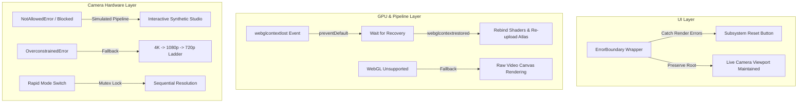

# Error Handling and Fault Tolerance

CineGrid Pro implements multi-layered fault isolation to ensure that hardware disconnects, WebGL GPU context losses, corrupt file imports, permission denials, and network failures never crash the central camera preview.

---

## 1. Multi-Layer Fault Isolation Architecture



---

## 2. React Subsystem Error Boundaries

The [`ErrorBoundary`](file:///C:/Users/yates/.gemini/antigravity/scratch/cinegrid-cam/src/components/common/ErrorBoundary.tsx) component wraps all heavy modal subsystems (`PhotoStudioModal`, `LutStudioModal`, `ExportStudioModal`, `AdminLicenseModal`):

```tsx
<ErrorBoundary fallbackTitle="Color Studio Encountered an Error" onReset={handleReset}>
  <LutStudioModal ... />
</ErrorBoundary>
```

### Fault Isolation Guarantees:
- If an unhandled exception occurs inside a modal (e.g., corrupt image array buffer during tone curve rendering), only that modal crashes into a non-destructive fallback card.
- The live camera viewfinder, MediaStream tracks, and audio meters continue running at 60 FPS in the background.
- Clicking **"Reset Module"** resets component state and remounts the child hierarchy cleanly.

---

## 3. WebGL GPU Context Loss Recovery

Mobile GPUs frequently reclaim WebGL contexts when the device is locked, switched to another application, or experiences thermal spikes.

### Recovery Implementation in `WebGLLutPipeline`:
```typescript
canvas.addEventListener('webglcontextlost', (e) => {
  e.preventDefault(); // Prevents browser from permanently dropping context
  this.isContextLost = true;
  console.warn('[WebGLPipeline] GPU context lost. Awaiting restoration...');
});

canvas.addEventListener('webglcontextrestored', () => {
  console.info('[WebGLPipeline] GPU context restored. Re-compiling shaders...');
  this.initShaders();
  this.allocateAtlasTexture();
  if (this.currentLut) {
    this.uploadLutAtlas(this.currentLut);
  }
  this.isContextLost = false;
});
```

---

## 4. Camera Hardware Fallbacks

### A. Permission Denial (`NotAllowedError`)
When the user denies camera/microphone permissions or the device lacks camera hardware (e.g. desktop virtual machines):
- `CameraService` catches the exception without unhandled rejections.
- The app initializes the **Simulated Studio Engine**: a dynamic canvas simulating exposure, focus changes, camera noise, and grid alignment.
- Users can test all 25+ composition grids, color LUTs, and export workflows without real camera hardware.

### B. Resolution Ladder Fallback (`OverconstrainedError`)
When requesting 4K or 60 FPS constraints unsupported by budget smartphone sensors:
```typescript
// Resolution negotiation ladder
const RESOLUTION_LADDER = [
  { width: 3840, height: 2160 }, // 4K UHD
  { width: 1920, height: 1080 }, // Full HD 1080p
  { width: 1280, height: 720 },  // HD 720p
  { width: 640, height: 480 },   // SD 480p
];
```
If `getUserMedia()` rejects the top resolution with `OverconstrainedError`, the engine catches the failure and retries down the ladder until negotiation succeeds.

---

## 5. Corrupt File Parsing Protection

### `.cube` Validation Matrix:
The [`cubeParser`](file:///C:/Users/yates/.gemini/antigravity/scratch/cinegrid-cam/src/utils/cubeParser.ts) performs defensive verification:
1. **Size Checking:** Files larger than 25 MB are rejected to prevent heap exhaustion.
2. **Dimension Verification:** Scans for `LUT_3D_SIZE`. Must be within supported range ($2 \le N \le 65$).
3. **Data Completeness:** Rejects files where parsed RGB line count $< N^3$.
4. **NaN and Range Validation:** Each floating-point number is checked via `Number.isFinite()`. Out-of-range coordinates ($< 0.0$ or $> 1.0$) are clamped rather than failing silently or causing GPU artifacts.

---

## 6. Offline Entitlement Resilience

If the remote licensing server is down or the photographer is shooting in remote offline environments:
- `LicenseService` verifies the stored cryptographic HMAC token locally.
- Checks `offlineUntil` timestamp.
- Grants an offline grace period (up to 7 days from last successful online validation) so user access is never interrupted during live commercial shoots.
