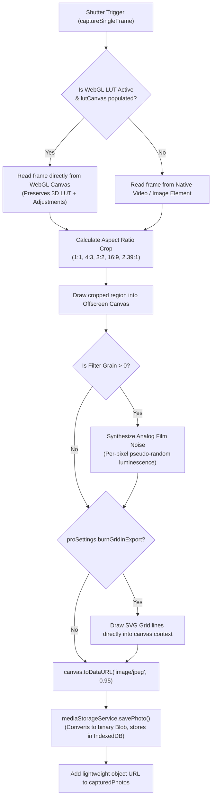

# High-Resolution Image Processing Pipeline — CineGrid Pro

This document details the image processing pipeline, rasterization engines, tone adjustments, film grain synthesis, and export workflows implemented in CineGrid Pro.

---

## 1. Image Capture & Processing Architecture



---

## 2. Analog Film Grain Synthesis

Digital sensors often appear sterile. When vintage or film stock filters (such as `Kodak Vision 5207` or `Vintage Fade`) are active, CineGrid Pro synthesizes analog silver-halide film grain:

```ts
if (filter.grain > 0 && filterStrength > 10) {
  const grainStrength = (filter.grain / 100) * (filterStrength / 100) * 0.12;
  const imgData = ctx.getImageData(0, 0, canvas.width, canvas.height);
  const pixels = imgData.data;
  
  for (let i = 0; i < pixels.length; i += 4) {
    const noise = (Math.random() - 0.5) * 255 * grainStrength;
    pixels[i]     = Math.min(255, Math.max(0, pixels[i] + noise));     // Red
    pixels[i + 1] = Math.min(255, Math.max(0, pixels[i + 1] + noise)); // Green
    pixels[i + 2] = Math.min(255, Math.max(0, pixels[i + 2] + noise)); // Blue
  }
  ctx.putImageData(imgData, 0, 0);
}
```

---

## 3. Post-Capture Lightroom Photo Editing Studio ([`src/utils/studioEngine.ts`](file:///C:/Users/yates/.gemini/antigravity/scratch/cinegrid-cam/src/utils/studioEngine.ts))

When editing photos in the dedicated photo editor:
1. **Light & Tonal Shaping:**
   - Exposure factor: $2.0^{\text{EV}}$
   - Contrast centering around midpoint $0.5$
   - Whites/Blacks clipping and highlight/shadow recovery
2. **RGB Tone Curve Spline Evaluation:**
   - 4 Independent channels: RGB composite, Red, Green, Blue.
   - Evaluates cubic Catmull-Rom splines across user control points.
   - Generates a 256-entry lookup table (LUT) per channel for high-speed rasterization.
3. **8-Channel HSL Color Mixer:**
   - Colors are mapped from RGB to HSV space.
   - Hue shifts, saturation boosts, and luminance adjustments are applied to 8 color ranges (Red, Orange, Yellow, Green, Aqua, Blue, Purple, Magenta) using smooth Gaussian angular weights.
4. **Geometric Perspective Correction:**
   - Canvas transform matrix applies rotation, horizontal keystone keystone angle, and vertical keystone perspective distortion.

---

## 4. Memory Considerations & Zero Base64 Heap Thrashing

Previous camera applications store all captured images as full-resolution Base64 data URLs inside React state. A single 12MP photograph encoded in Base64 occupies ~16MB of V8 memory. Burst shooting 10 photos consumes 160MB of RAM, causing garbage collection pauses and browser tab crashes on iOS Safari and low-end Android devices.

CineGrid Pro resolves this through **Binary IndexedDB Separation**:
1. When captured, photos are converted to native binary `Blob`s.
2. The blob is saved to IndexedDB (`photo_blobs` store) via `mediaStorageService.savePhoto()`.
3. In-memory `CapturedPhoto` objects retain only metadata and lightweight `blob:` URLs generated through `ResourceManager`.
4. An LRU cache holds up to 25 active object URLs, revoking old ones via `URL.revokeObjectURL` to ensure that memory usage stays flat regardless of how many hundreds of photos are taken.
