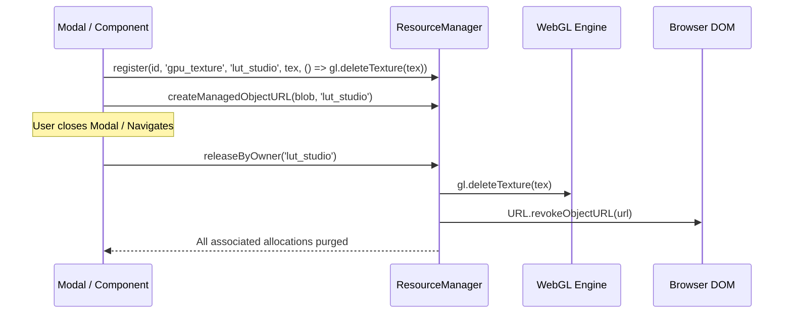

# Memory Management and Leak Prevention

CineGrid Pro is designed for sustained, intensive camera sessions on mobile hardware with constrained RAM (2 GB – 6 GB). Camera video frames, WebGL textures, audio context analyzers, and high-resolution photo bursts can rapidly consume memory if not managed through rigorous lifecycle boundaries.

---

## 1. Centralized Resource Management (`ResourceManager`)

The [`ResourceManager`](file:///C:/Users/yates/.gemini/antigravity/scratch/cinegrid-cam/src/services/resourceManager.ts) is an application-wide singleton that tracks, audits, and disposes of all browser and WebGL resources.

### 13 Managed Resource Types

```typescript
export type ManagedResourceType =
  | 'stream'           // MediaStream (Camera & Microphones)
  | 'track'            // MediaStreamTrack (Video & Audio tracks)
  | 'video_element'    // HTMLVideoElement (Video DOM nodes)
  | 'canvas_element'   // HTMLCanvasElement
  | 'webgl_context'    // WebGL2RenderingContext / WebGLRenderingContext
  | 'gpu_texture'      // WebGLTexture allocations
  | 'shader_program'   // WebGLProgram compilation objects
  | 'buffer'           // ArrayBuffer / Float32Array allocations
  | 'object_url'       // Blob URL references (URL.createObjectURL)
  | 'worker'           // Web Workers (cube parser worker)
  | 'event_listener'   // Window/Document global listeners
  | 'timer'            // setInterval / setTimeout handles
  | 'audio_context';   // AudioContext for VU meter monitoring
```

---

## 2. Resource Ownership and Scoped Cleanup

Every managed resource is assigned an `ownerId`. When a subsystem, modal, or component unmounts, it invokes `resourceManager.releaseByOwner(ownerId)` to guarantee that no orphaned resources remain in memory.

### Cleanup Lifecycles:



---

## 3. Dynamic Device Memory Profiling

On startup, `ResourceManager` evaluates client hardware capabilities to adjust runtime memory budgets:

```typescript
export interface DeviceMemoryProfile {
  deviceMemoryGb: number;       // navigator.deviceMemory || 4
  hardwareConcurrency: number;  // navigator.hardwareConcurrency || 4
  maxLutCacheCount: number;     // 4 (low-mem) or 8 (high-end)
  maxImageCacheMb: number;      // 64 MB (low-mem) or 256 MB (high-end)
  targetPreviewFps: number;     // 30 fps (low-mem) or 60 fps (high-end)
  preferLowMemory: boolean;     // true if <= 2GB RAM or <= 2 CPU cores
}
```

### Dynamic Budget Adaptations:
- **Low-Memory Devices (≤ 2 GB RAM):**
  - Preview frame rate throttled to 30 FPS.
  - Active LUT shader atlas cached count capped at 4.
  - Image preview canvas buffer clamped to 1080p resolution.
- **High-End Devices (≥ 4 GB RAM):**
  - 60 FPS full-resolution rendering pipeline enabled.
  - Up to 8 LUT textures hot in memory.

---

## 4. Object URL and Blob Lifecycle

Object URLs (`blob:http://...`) provide high-speed zero-copy rendering of binary images. However, if not explicitly revoked via `URL.revokeObjectURL()`, browser memory leaks persist until the entire page is refreshed.

### Prevention Architecture:
1. **Creation:** All Object URLs must be registered via `resourceManager.createManagedObjectURL(blob, ownerId)`.
2. **LRU Eviction:** Active gallery previews are capped at 25 entries in `mediaStorageService`. Evicted entries automatically invoke `revokeManagedObjectURL()`.
3. **Emergency Cleanup:** On window `beforeunload` or `pagehide` events, `resourceManager.cleanupAll()` sweeps through `objectUrls: Set<string>` and calls `URL.revokeObjectURL()` on every active URL.

---

## 5. WebGL VRAM Leak Prevention

Repeatedly destroying and allocating WebGL textures when switching LUTs causes severe VRAM fragmentation and GC pauses on mobile GPUs.

### The Zero-Allocation Atlas Pattern:
Instead of allocating a new `gl.createTexture()` on every LUT change:
1. `WebGLLutPipeline` allocates **exactly one** 2D atlas texture on initialization:
   ```typescript
   gl.texImage2D(gl.TEXTURE_2D, 0, gl.RGBA, 1024, 32, 0, gl.RGBA, gl.UNSIGNED_BYTE, null);
   ```
2. When switching LUTs, the pipeline reuses the pre-allocated VRAM buffer using `gl.texSubImage2D()`:
   ```typescript
   gl.texSubImage2D(gl.TEXTURE_2D, 0, 0, 0, width, height, gl.RGBA, gl.UNSIGNED_BYTE, data);
   ```
3. Context loss (`webglcontextlost`) and context restoration (`webglcontextrestored`) are explicitly handled to rebind shader programs without memory leaks.

---

## 6. Event Listeners and Timers

To prevent memory leaks from retained closure variables:
- Device orientation listeners are registered via `resourceManager.registerEventListener()`.
- VU meter polling and timecode tickers are registered via `resourceManager.registerTimer()`.
- Component unmount hooks call `resourceManager.releaseByOwner()`, cleanly unbinding DOM listeners and clearing all timer IDs.
