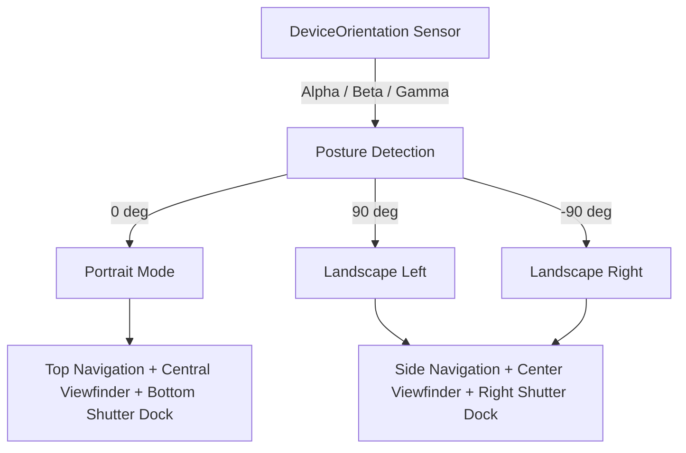

# Responsive Design and Multi-Platform Adaptation

CineGrid Pro delivers a native camera app experience across smartphones, tablets, and desktop workstations. The interface dynamically adapts to varied screen geometries, hardware display notches, dynamic islands, and device orientations without stretching or distorting the camera aspect ratio.

---

## 1. Safe Area Inset System

Smartphones with physical camera cutouts, rounded display corners, or home indicator bars require dynamic viewport padding to prevent touch controls from being obscured.

### CSS Environment Variable Insets
Defined in [`src/index.css`](file:///C:/Users/yates/.gemini/antigravity/scratch/cinegrid-cam/src/index.css):

```css
.safe-top {
  padding-top: env(safe-area-inset-top, 0px);
}
.safe-bottom {
  padding-bottom: env(safe-area-inset-bottom, 0px);
}
.safe-left {
  padding-left: env(safe-area-inset-left, 0px);
}
.safe-right {
  padding-right: env(safe-area-inset-right, 0px);
}
.safe-area-container {
  padding-top: env(safe-area-inset-top, 0px);
  padding-bottom: env(safe-area-inset-bottom, 0px);
  padding-left: env(safe-area-inset-left, 0px);
  padding-right: env(safe-area-inset-right, 0px);
}
```

- **Top Bar (`MainNavigationBar`):** Incorporates `.safe-top` so battery indicators, time labels, and system status bars do not clip camera telemetry pills.
- **Bottom Shutter Dock (`ShutterDock`):** Incorporates `.safe-bottom` to ensure the capture button and gallery thumbnail sit safely above iOS home indicators and Android gesture bars.

---

## 2. Dynamic Orientation Architecture

CineGrid Pro supports three orientation postures:



### Unrotated Viewfinder Sensor Guarantee:
While interface icons and telemetry pills rotate cleanly to match the device posture, the **camera sensor feed and composition grid lines remain unmirrored and geometrically locked** to real-world physics, matching professional cinema rigs (Blackmagic Pocket Cinema Camera, ARRI Alexa Mini).

---

## 3. Aspect Ratio Framing & Math

Professional cameras must preview exact sensor crops without distorting the underlying video feed. CineGrid Pro computes precision letterboxing / pillarboxing:

| Aspect Ratio | Pro Ratio | Target Genre / Format | Framing Behavior |
| :--- | :--- | :--- | :--- |
| **`16:9`** | `1.777:1` | Standard HD / 4K Broadcast & YouTube | Horizontal pillarbox in portrait; full width in landscape |
| **`9:16`** | `0.562:1` | TikTok, Instagram Reels, Shorts | Vertical full height in portrait; pillarboxed on desktop |
| **`4:3`** | `1.333:1` | Medium Format & Classic Photography | Uses native smartphone sensor area without crop |
| **`1:1`** | `1.000:1` | Square Portrait & Product Photography | Symmetrical square mask with darkened matte surround |
| **`2.39:1`** | `2.390:1` | Anamorphic Cinema Scope | Anamorphic matte bars overlaid across sensor feed |

---

## 4. Touch Ergonomics & Mobile-First Controls

- **Minimum Touch Target:** All interactive controls (pills, shutter buttons, dials) adhere to an ergonomic minimum dimension of $44 \times 44\text{ px}$.
- **Touch Callout Suppression:** `-webkit-tap-highlight-color: transparent` and `user-select: none` prevent mobile browsers from showing magnifying glasses, text selection highlights, or gray callout overlays during multi-touch camera interactions.
- **Haptic Tactile Feedback:** The capture shutter, EV tick dial, and mode switchers trigger native vibration impulses (`deviceService.vibrate(15)` or `10ms` clicks on supported devices) to confirm user input without audio clicks interfering with microphone recordings.

---

## 5. Tablet & Desktop Responsive Layouts

When loaded on wide screens ($\ge 768\text{ px}$ tablets or desktop monitors):
- The central camera viewport is clamped to its native aspect ratio with a subtle cinematic drop shadow.
- Studio editing tools (`PhotoStudioModal`) expand from single-column vertical drawers into a multi-column desktop layout featuring a persistent left thumbnail inspector, central 4K canvas workspace, and right adjustment panel.
- Pro HUD telemetry distributes horizontally across the top bezel, mimicking studio broadcast monitor displays.
