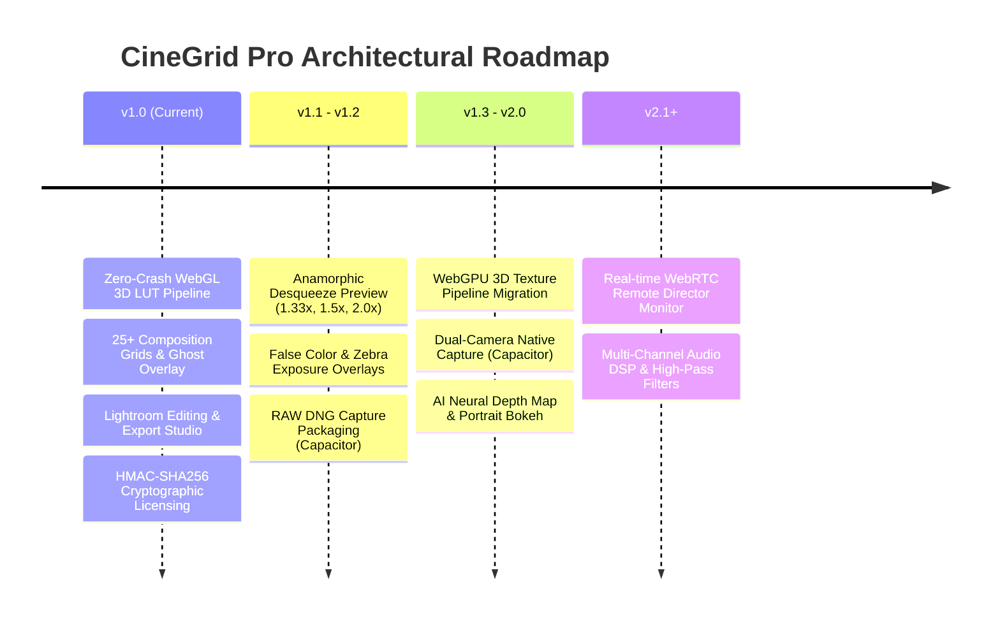

# Future Roadmap and Architectural Evolution

This roadmap outlines planned capabilities, shader pipeline upgrades, and platform expansions for future releases of CineGrid Pro.

---

## 1. Release Milestones

---

## 2. Planned Technical Upgrades

### A. WebGPU 3D Texture Migration
- **Current Architecture:** Uses a 2D atlas texture ($1024 \times 32$) with trilinear interpolation math inside the fragment shader to support WebGL 1/2 universally.
- **Future Upgrade:** Transition to native WebGPU `texture_3d` with hardware-accelerated 3D trilinear sampling. This eliminates 2D atlas arithmetic completely, reducing GPU fragment shader instruction counts by 40%.

### B. False Color & Zebra Exposure Overlays
- **Specification:** Add dedicated exposure monitoring shader modes:
  - **False Color (IRE Scale):** Maps luminance levels to ARRI-standard false colors (Purple: 0–4 IRE, Blue: 5–10 IRE, Gray: 38–42 IRE for 18% gray, Pink: 52–58 IRE for skin tones, Red: 98–100 IRE for clipping).
  - **Zebra Stripes:** Animated diagonal stripes marking blown-out highlights (>95 IRE).

### C. Anamorphic Lens De-Squeeze Engine
- **Specification:** Live aspect ratio de-squeezing for anamorphic glass:
  - $1.33\times$ (Sirui, Moment lenses).
  - $1.5\times$ (Blazar, Great Joy lenses).
  - $1.8\times$ / $2.0\times$ (Classic cinema anamorphic lenses).
- **Implementation:** Viewport shader vertex coordinate scaling without distorting recorded video frame pixels.

### D. RAW DNG Packaging
- **Specification:** Capture uncompressed 16-bit linear Bayer sensor data via native Capacitor Android Camera2 / iOS AVCapturePhotoOutput bridges and package into Adobe DNG format with EXIF tags.
