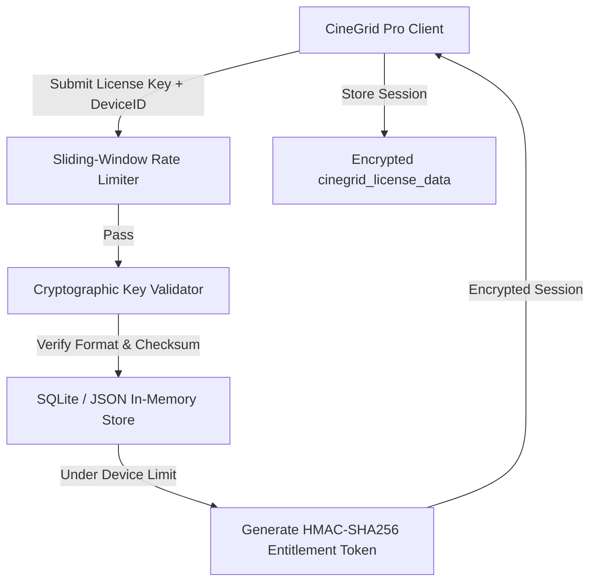

# Security Architecture and Licensing System

CineGrid Pro includes a hardened licensing and entitlement subsystem designed to protect professional software features, prevent brute-force key generation, and enforce device limits while maintaining uninterrupted offline capabilities for traveling photographers.

---

## 1. Security Model Overview



---

## 2. Cryptographic Key Format

License keys conform to a strict, checksummed canonical format:

$$\text{Format: } \texttt{CGP-[TIER]-[RANDOM-HEX]-[CHECKSUM]}$$

- **Prefix:** `CGP` (CineGrid Pro identifier).
- **Tiers:**
  - `30D`: 30-Day Commercial Trial.
  - `90D`: 90-Day Seasonal License.
  - `1YR`: 1-Year Studio Subscription.
  - `LIFE`: Lifetime Studio Enterprise.
- **Checksum:** Deterministic HMAC nibble calculated over the key payload to reject randomly typed strings instantly without hitting the database.

---

## 3. HMAC-SHA256 Entitlement Tokens

When a license key is successfully activated on a device, the backend generates a signed entitlement token containing:
- Device hardware identifier (`deviceId`).
- Entitlement expiration date (`expiresAt`).
- Offline validity threshold (`offlineUntil`).
- Active tier and feature flags.

```typescript
// Token Generation (server/licenseApi.ts)
const header = Buffer.from(JSON.stringify({ alg: 'HS256', typ: 'JWT' })).toString('base64url');
const payload = Buffer.from(JSON.stringify({
  licenseId: license.id,
  deviceId,
  tier: license.type,
  exp: license.expiresAt,
  offlineUntil: Date.now() + (7 * 24 * 60 * 60 * 1000) // 7-day offline grace
})).toString('base64url');

const signature = crypto
  .createHmac('sha256', secretKey)
  .update(`${header}.${payload}`)
  .digest('base64url');

const entitlementToken = `${header}.${payload}.${signature}`;
```

The client verifies this token on startup. If the signature matches and `Date.now() < offlineUntil`, features remain unlocked even in complete absence of network connectivity.

---

## 4. API Hardening & Abuse Prevention

### Sliding-Window Rate Limiter
The license server enforces a strict rate limit on activation attempts:
- **Rule:** Maximum 8 activation requests per IP/device per 60-second sliding window.
- **Excess Attempts:** HTTP 429 Too Many Requests returned immediately.

### Payload Flood Protection
```typescript
let body = '';
req.on('data', (chunk) => {
  body += chunk;
  if (body.length > 1e6) { // 1 MB flood threshold
    req.destroy();
    reject(new Error('Payload too large'));
  }
});
```

### Admin Dashboard Security
- **Authentication:** Admin actions (generating keys, revoking licenses, adjusting device limits) require an admin bearer token.
- **Token Validity:** Tokens are cryptographically signed with HMAC-SHA256 and expire automatically after 24 hours.

---

## 5. Client-Side Data Protection

1. **No Untrusted HTML Execution:** All dynamic labels, camera parameters, and metadata are rendered using React JSX text nodes; `dangerouslySetInnerHTML` is strictly prohibited.
2. **File Import Boundary:** Imported `.cube` and image files are read via `FileReader` as plain text or array buffers. Script execution inside imported assets is physically impossible in the browser sandbox.
3. **CORS Isolation:** The API server enforces explicit `Access-Control-Allow-Origin` and `Access-Control-Allow-Headers` rules.
