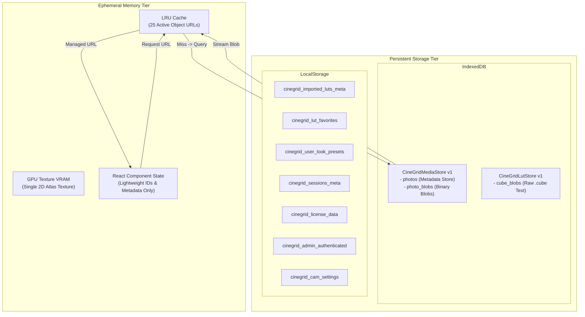

# Storage Architecture and Caching System

CineGrid Pro employs a tiered storage architecture engineered to prevent memory exhaustion (OOM), eliminate large Base64 strings from thrashing the V8 Garbage Collector, and ensure persistent offline retention of raw photography assets, 3D LUT files, and session states across mobile and desktop environments.

---

## 1. Storage Tier Architecture



---

## 2. IndexedDB Storage Engine

CineGrid Pro isolates binary heavy data from indexable metadata across two dedicated IndexedDB databases:

### A. Media Store: `CineGridMediaStore` (v1)
Managed by [`MediaStorageService`](file:///C:/Users/yates/.gemini/antigravity/scratch/cinegrid-cam/src/services/mediaStorageService.ts):

| Store Name | Primary Key | Description | Payload Schema |
| :--- | :--- | :--- | :--- |
| `photos` | `id` (string) | Captured photo metadata | `{ id, timestamp, format, aspectRatio, iso, shutterSpeed, ev, kelvin, filterId, lutId, hasBlob: true, blobSize: number, dataUrl: '' }` |
| `photo_blobs` | `id` (string) | High-resolution binary payload | `{ id: string, blob: Blob }` |

#### The Binary Separation Pattern
Early implementations stored complete Base64 data URLs (`data:image/jpeg;base64,...`) directly in React state and LocalStorage. For a 12 MP image, this represented 16 MB of UTF-16 string memory per image. Querying a gallery of 30 photos forced the JS runtime to allocate 480 MB of heap memory, triggering mobile browser tab crashes.

In `MediaStorageService.savePhoto()`:
```typescript
// Base64 is stripped from the metadata store to keep indices lightweight (<1 KB)
const meta = {
  ...photo,
  dataUrl: '', // Stripped from meta table
  hasBlob: true,
  blobSize: blob.size,
};

photoStore.put(meta);
blobStore.put({ id: photo.id, blob });
```

### B. LUT Store: `CineGridLutStore` (v1)
Managed by [`LutStorageService`](file:///C:/Users/yates/.gemini/antigravity/scratch/cinegrid-cam/src/services/lutStorageService.ts):

| Store Name | Primary Key | Description | Payload Schema |
| :--- | :--- | :--- | :--- |
| `cube_blobs` | `id` (string) | Raw `.cube` file contents | `{ id: string, name: string, rawCube: string, importDate: number }` |

This prevents multi-megabyte 65×65×65 3D LUT definition files (up to 8 MB each) from hitting LocalStorage 5 MB quota limits.

---

## 3. LRU Object URL Cache

Generating `URL.createObjectURL(blob)` allows the browser to read image buffers directly via internal C++ pointers without copying bytes into JS memory. However, unrevoked Object URLs remain in browser memory indefinitely.

`MediaStorageService` integrates a custom [`LRUCache<string, string>`](file:///C:/Users/yates/.gemini/antigravity/scratch/cinegrid-cam/src/utils/lruCache.ts):

```typescript
this.objectUrlCache = new LRUCache<string, string>({
  maxEntries: 25,
  onEvict: (_id, url) => {
    resourceManager.revokeManagedObjectURL(url);
  },
});
```

### Retrieval Lifecycle:
1. `getPhotoObjectUrl(photoId)` is invoked by UI/gallery components.
2. If `photoId` is present in `objectUrlCache`, it returns the active URL and bumps it to the most-recently-used position.
3. If absent, `photo_blobs` is queried from IndexedDB.
4. When retrieved, `resourceManager.createManagedObjectURL(blob, 'gallery_viewer')` creates the pointer.
5. The URL is cached. If cache size exceeds 25 entries, the oldest URL is evicted and immediately revoked via `URL.revokeObjectURL()`.

---

## 4. LocalStorage Schema & Key Registry

All LocalStorage keys are strictly prefixed with `cinegrid_`:

| Key | Type | Owner Service / Component | Description |
| :--- | :--- | :--- | :--- |
| `cinegrid_cam_settings` | `JSON Object` | `useCameraSettings` | Persists user preferences: grid type, flash mode, camera facing, exposure compensation |
| `cinegrid_lut_favorites` | `string[]` | `LutStorageService` | Array of LUT IDs flagged as user favorites |
| `cinegrid_user_look_presets` | `UserLookPreset[]` | `LutStorageService` | User-defined color grading recipes (LUT ID, intensity, tint, temp, contrast) |
| `cinegrid_sessions_meta` | `SessionMeta[]` | `SessionService` | Photography session metadata (client name, location, target shot count) |
| `cinegrid_license_data` | `LicensePayload` | `LicenseService` | Stored cryptographically signed activation token and device hardware fingerprint |
| `cinegrid_admin_authenticated` | `string ('true'/'false')` | `LicenseService` | Admin dashboard authentication flag with session timeout |

---

## 5. Storage Quotas and Graceful Degradation

- **Desktop Browsers:** IndexedDB quota typically ranges from 10 GB to 60% of available disk space.
- **iOS Safari / WebKit:** IndexedDB has strict limits (~1 GB) and may evict origin storage if device storage is critically low (<500 MB free).
- **Graceful Fallback:** If `window.indexedDB` is blocked (e.g. Private Browsing mode with strict security policies), `LutStorageService` and `MediaStorageService` catch the failure during `init()` and seamlessly degrade to in-memory caching and base64 fallbacks without throwing uncaught exceptions.
