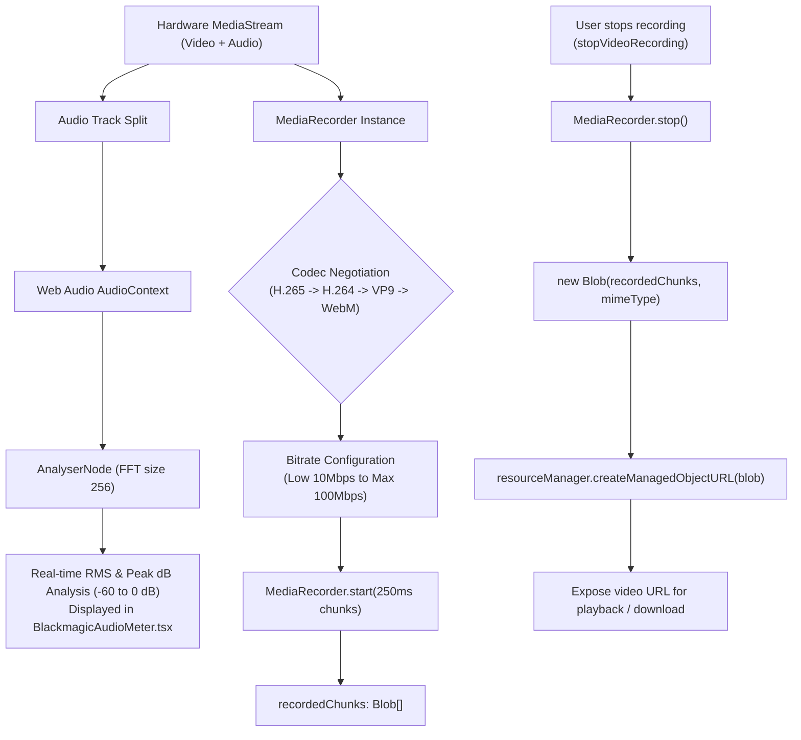

# Video Processing & Audio Recording Architecture — CineGrid Pro

CineGrid Pro implements a high-throughput, cinema-grade video recording pipeline in [`src/services/cameraService.ts`](file:///C:/Users/yates/.gemini/antigravity/scratch/cinegrid-cam/src/services/cameraService.ts). It coordinates multi-codec recording, custom bitrates, SMPTE timecodes, storage quota estimation, and real-time audio VU meters.

---

## 1. Video Recording Pipeline Architecture

---

## 2. Multi-Codec Negotiation & Bitrate Profiles

### A. Supported Codec Hierarchy
Browser and mobile platform support for video codecs varies. `CameraService.startVideoRecording` probes `MediaRecorder.isTypeSupported()` and negotiates the optimal available container:
1. **H.265 / HEVC (`video/mp4;codecs=hevc`, `video/mp4;codecs=hvc1`):** Highest compression efficiency for 4K video.
2. **H.264 / AVC (`video/mp4;codecs=avc1`, `video/webm;codecs=h264`):** Industry standard with universal playback across all mobile players.
3. **VP9 (`video/webm;codecs=vp9`):** High-efficiency open web video format.
4. **Standard WebM / MP4 Fallback:** Default container if specific codecs are unsupported.

### B. Bitrate Profiles
Bitrate determines visual quality, compression artifacts, and file size:
- **Low:** `10,000,000` bps (10 Mbps) — Efficient for long-form recording and storage conservation.
- **Medium (Default):** `25,000,000` bps (25 Mbps) — Balanced high-definition mobile streaming standard.
- **High:** `50,000,000` bps (50 Mbps) — High-bitrate broadcast capture with sharp detail.
- **Maximum:** `100,000,000` bps (100 Mbps) — Master quality recording for post-production grading.

---

## 3. Web Audio VU Metering & Audio Input Selection

To ensure clean sound recording without clipped dialogue:
1. **Web Audio Analyser:**
   An `AudioContext` and `AnalyserNode` (`fftSize = 256`, `smoothingTimeConstant = 0.4`) read time-domain audio data (`Uint8Array`) from the active audio track at 60 FPS.
2. **Root-Mean-Square (RMS) & Peak Decibels:**
   Normalized amplitude is converted to decibels:
   $$\text{RMS} = \sqrt{\frac{1}{N} \sum_{i=1}^N x_i^2}$$
   $$\text{dB} = 20 \times \log_{10}(\max(0.001, \text{RMS}))$$
   Clamped between $-60\text{ dB}$ (silence) and $0\text{ dB}$ (digital maximum).
3. **Clipping Alert:**
   If peak amplitude exceeds $0.95$ ($>-0.5\text{ dB}$), a red visual clipping indicator lights up on the Blackmagic HUD.
4. **External Microphones:**
   `cameraService.enumerateAudioInputs()` detects connected USB microphones, 3.5mm lavaliers, and Bluetooth audio devices.

---

## 4. SMPTE Timecode Formatter & Storage Quota Estimation

1. **Timecode Modes (`cameraService.formatTimecode`):**
   - **Record Run (`record_run`):** Increments strictly while recording is active, formatted as `HH:MM:SS:FF` where `FF` represents the exact video frame ($0$ to $\text{FPS}-1$).
   - **Time of Day (`time_of_day`):** Continuous clock-synchronized timecode matching real-world studio wall clocks.
2. **Storage Quota Estimation (`getStorageEstimate`):**
   - Queries `navigator.storage.estimate()` to obtain remaining disk bytes.
   - Computes remaining minutes based on the active bitrate:
     $$\text{Remaining Minutes} = \frac{\text{Free Bytes}}{\frac{\text{Bitrate}}{8} \times 60}$$
   - Displays real-time remaining record time on the Pro HUD (e.g. `124 min free`).
